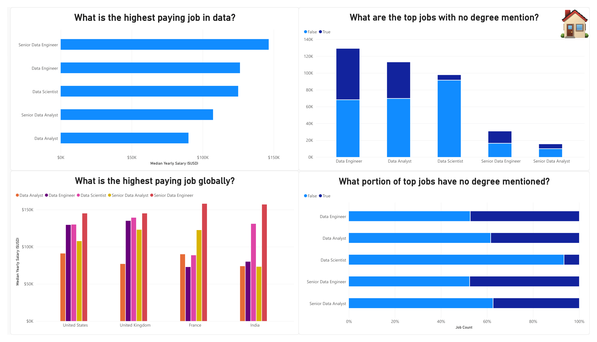
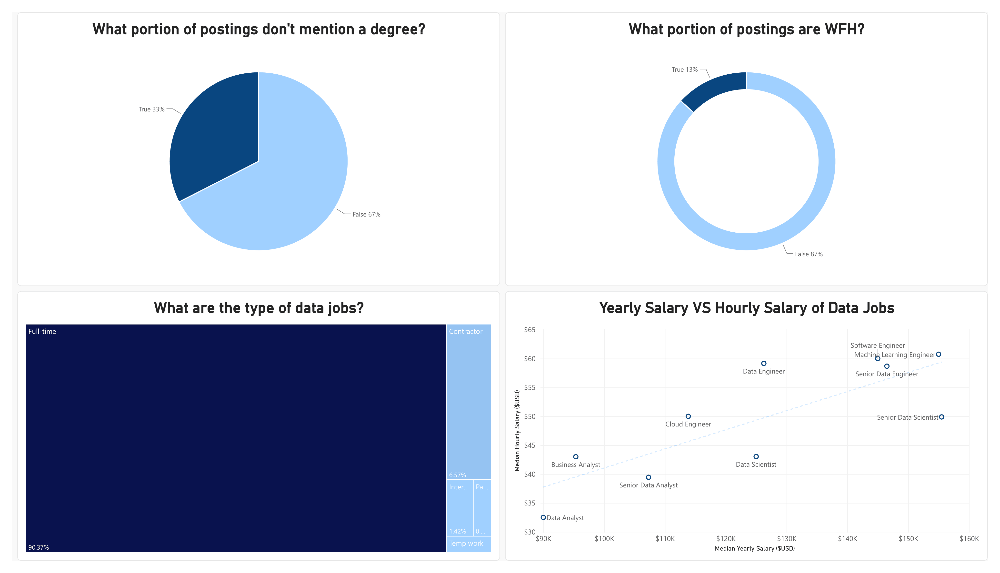
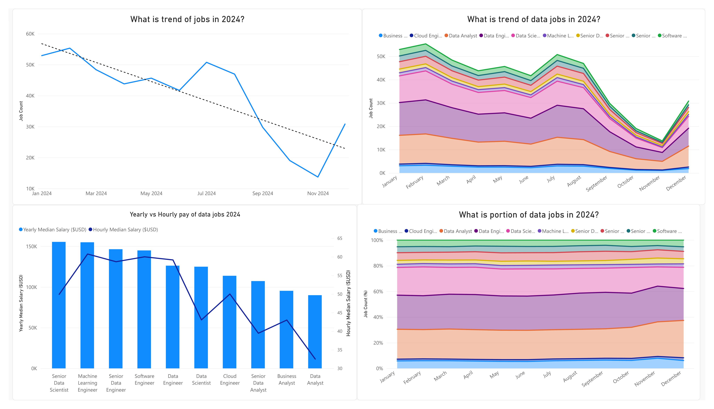
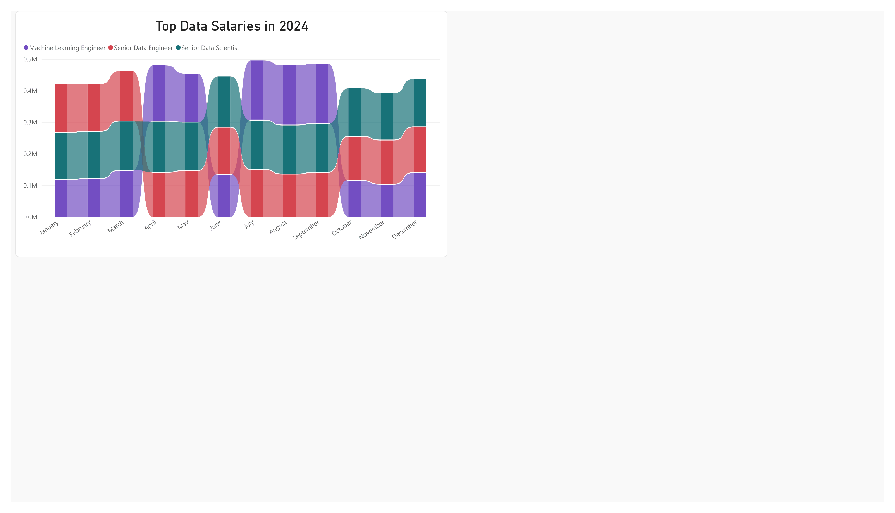
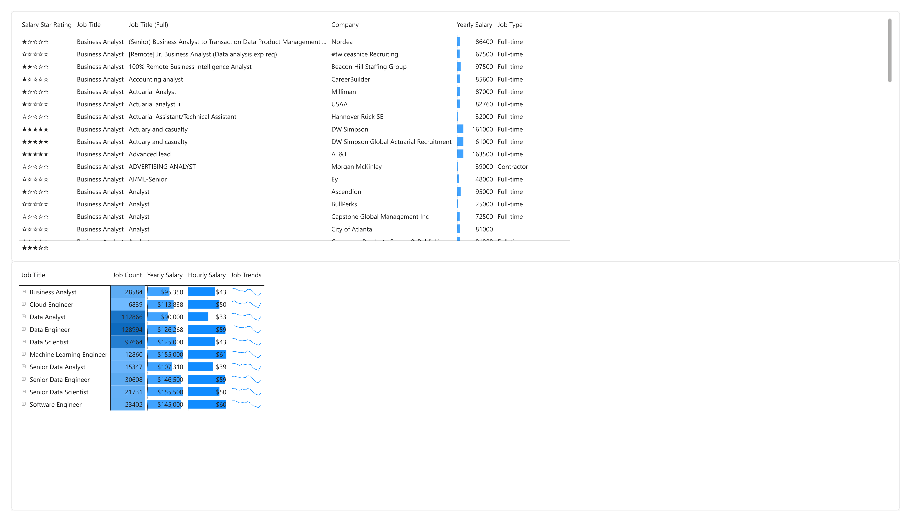
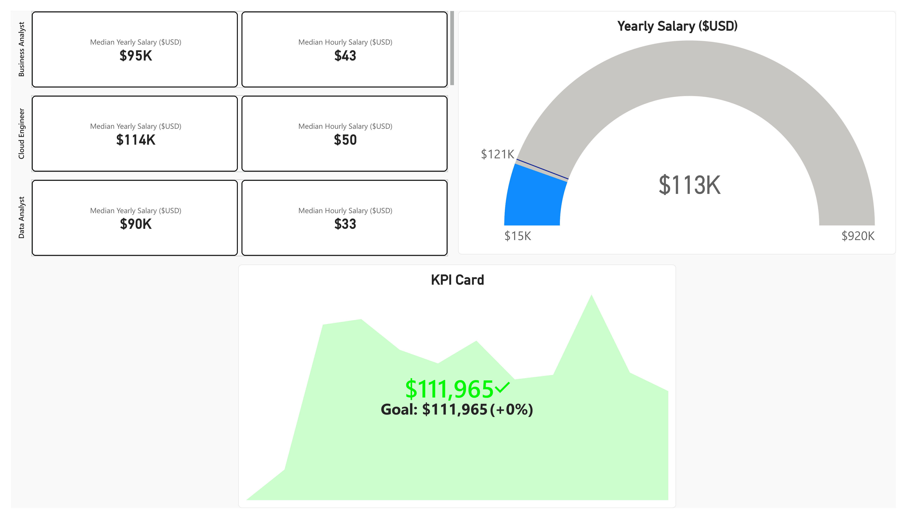
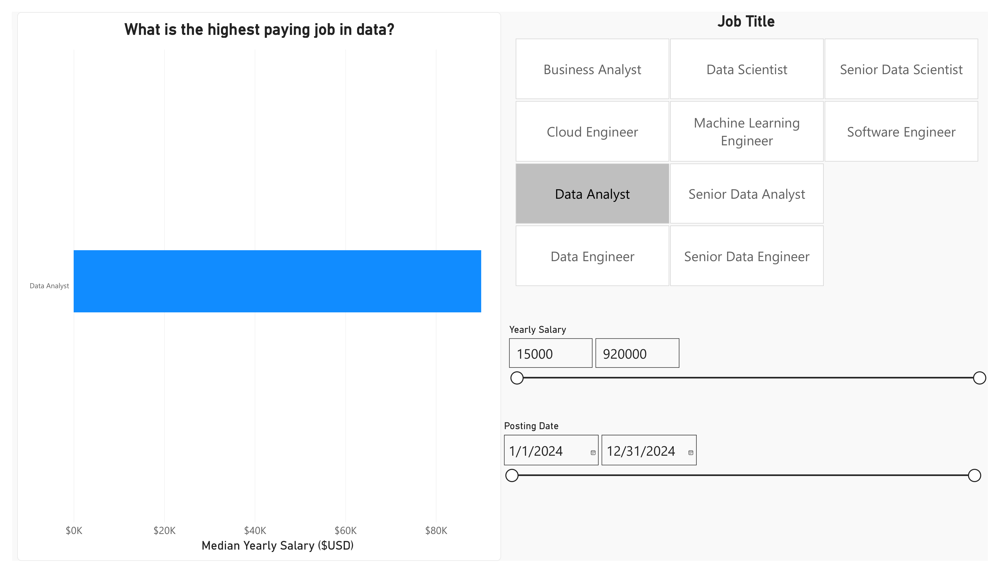
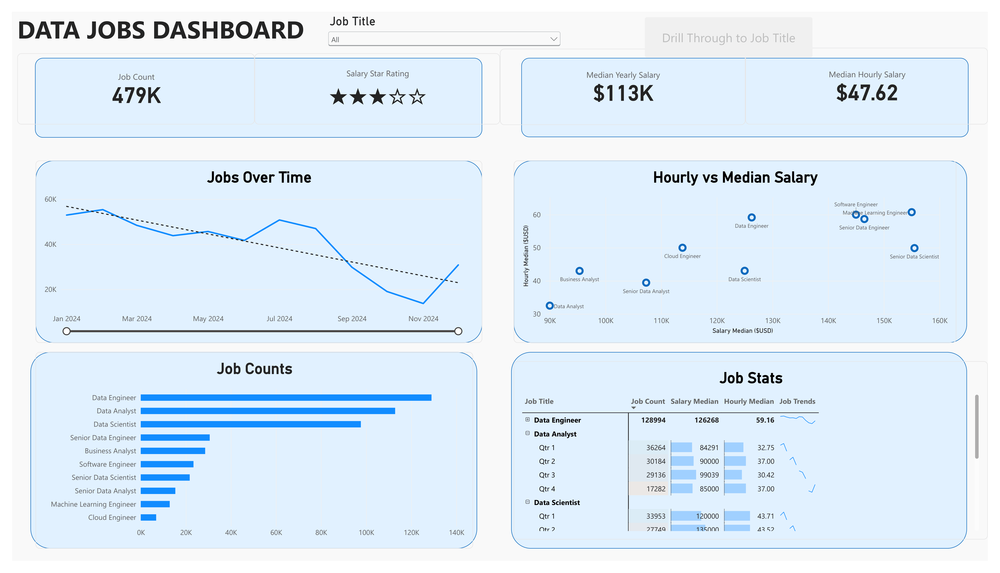
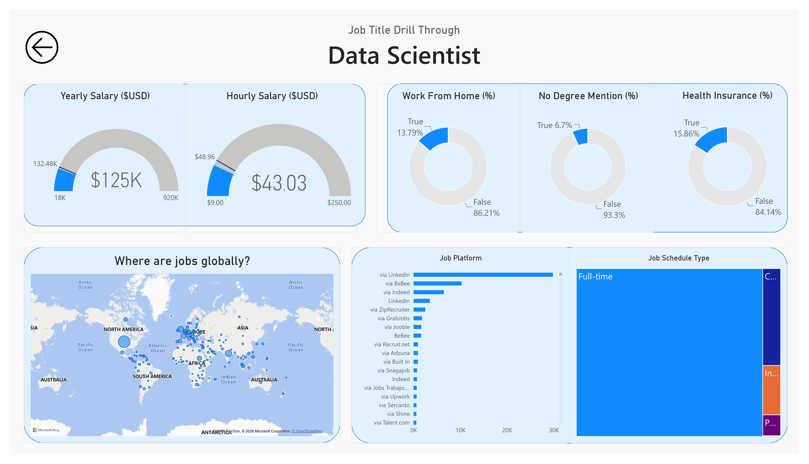

# Data Jobs: katalog visualisasi Power BI

Proyek belajar sekaligus etalase **Power BI**: 11 halaman laporan, tiap halaman memakai satu keluarga visual (column & bar, pie/donut/icicle/scatter, line & area, maps, ribbon, tabel & matriks, KPI & gauge, slicer), ditutup dasbor interaktif dan halaman drill-through per jabatan. Screenshot di bawah diambil langsung dari tiap halaman laporan.

## Dataset

`job_postings_flat.csv`: **478.895 lowongan** kerja bidang data yang diposting sepanjang 2024. Kolom utama: job title, location, platform, job schedule type, jpb wfh, degree mentioned, health insurance, yearly salary atau hourly salary, dan skill.

### 1. Column & Bar Chart — highest salary job

**Temuan utama:**

- **Senior Data Engineer** memimpin gaji median tahunan (sekitar $145 rb), diikuti Data Engineer dan Data Scientist (masing-masing kira-kira $122–125 rb); Senior Data Analyst dan Data Analyst di posisi terbawah.
- Untuk "top jobs with no degree mention", Data Engineer punya proporsi tanpa syarat gelar (biru terang) terbesar secara absolut, sementara Data Scientist proporsinya paling kecil dibanding total lowongannya — terlihat jelas di chart 100% stacked di kanan bawah.
- Gaji tertinggi berbeda per negara: di grafik "highest paying job globally", Senior Data Engineer konsisten tertinggi di keempat negara dengan job terbanyak (United States, United Kingdom, France, India), tapi urutan jabatan lain di bawahnya berubah-ubah antar negara.

### 2. Pie, Donut, Icicle & Scatter — profil lowongan

**Temuan utama:**

- **33%** lowongan tidak menyebut syarat gelar (pie kiri atas), tapi hanya **13%** yang bisa dikerjakan dari rumah (donut kanan atas).
- Chart icicle "type of data jobs" menunjukkan **Full-time mendominasi hampir seluruh (≈90%)** lowongan; Contractor, Internship, Part-time, dan Temp work bersama-sama hanya mengisi sisa yang tipis di ujung kanan.
- Scatter "Yearly vs Hourly Salary" memperlihatkan korelasi positif: Data Analyst di pojok kiri-bawah (gaji tahunan & per jam paling rendah), sedangkan Software Engineer dan Machine Learning Engineer di pojok kanan-atas (paling tinggi keduanya). Senior Data Scientist agak menyimpang dari garis tren — gaji tahunannya tinggi tapi gaji per jam relatif lebih rendah dari yang diperkirakan garis tren.

### 3. Line & Area Chart — tren sepanjang 2024

**Temuan utama:**

- Tren jumlah lowongan 2024 (kiri atas) **menurun** sepanjang tahun (garis putus-putus tren negatif), dengan titik terendah di sekitar **November** sebelum naik lagi di Desember.
- Stacked area per jabatan (kanan atas) menunjukkan pola musiman yang sama di semua jabatan — turun bersama dari pertengahan tahun ke November, lalu naik lagi — jadi penurunan ini bukan cuma satu jabatan, tapi pola pasar data secara keseluruhan.
- Kombinasi bar+line "Yearly vs Hourly pay" (kiri bawah) menegaskan urutan gaji: Senior Data Scientist dan Machine Learning Engineer teratas dari sisi gaji tahunan, tapi gaji per jam (garis) mereka justru turun untuk Senior Data Scientist — konsisten dengan anomali yang sama di scatter halaman sebelumnya.

### 4. Ribbon Chart — peringkat gaji berpindah tiap bulan

**Temuan utama:**

- Peringkat 3 jabatan bergaji tertinggi (Machine Learning Engineer, Senior Data Engineer, Senior Data Scientist) **berganti-ganti posisi tiap bulan** — terlihat dari pita yang saling menyilang, bukan garis lurus sejajar.
- Senior Data Engineer sempat memimpin di Januari–Maret, lalu Machine Learning Engineer mengambil alih di April–Mei dan Juli–September, sementara Senior Data Scientist naik ke puncak di Juni dan Oktober–Desember.
- Pola ini menunjukkan tidak ada satu jabatan yang secara konsisten "paling mahal" sepanjang tahun; peringkat gaji tahunan sangat sensitif terhadap bulan pengambilan data.

### 5. Table & Matrix — daftar lowongan dan ringkasan per job

**Temuan utama:**

- Tabel atas memuat setiap lowongan individual dengan kolom **Salary Star Rating** (bintang 0–5 dari ukuran DAX) di samping Job Title, Company, Yearly Salary, dan Job Type — cara memvisualkan gaji sebagai simbol bintang, bukan angka.
- Matriks bawah meringkas per jabatan: **Data Engineer** jumlah lowongan terbanyak (128.994, median $126.268), sedangkan **Data Analyst** terbanyak kedua (112.866) tapi median gajinya paling rendah dari 10 jabatan ($90.000).
- Kolom sparkline "Job Trends" di ujung kanan memberi gambaran naik-turun lowongan tiap jabatan sepanjang tahun tanpa perlu membuka chart tersendiri.

### 6. KPI & Gauge — ringkasan angka per kategori

**Temuan utama:**

- Kartu KPI kiri membandingkan 3 jabatan berdampingan: **Cloud Engineer** median gaji tahunan tertinggi di antara ketiganya ($114 rb) meski bukan yang paling terkenal, sedikit di atas Business Analyst ($95 rb) dan Data Analyst ($90 rb).
- Gauge "Yearly Salary" menunjukkan median keseluruhan **$113 rb**, berada di ujung bawah skala $15 rb–$920 rb — menandakan skala sumbu dibuat lebar karena ada outlier gaji sangat tinggi di data mentah.
- KPI Card bawah menampilkan target vs realisasi: **$111.965 dengan goal $111.965 (+0%)** — target disetel sama dengan nilai realisasi terakhir, jadi kartu ini lebih berfungsi sebagai demo visual KPI-vs-goal daripada target bisnis sungguhan.

### 7. Slicer — filter interaktif

**Temuan utama:**

- Halaman ini murni demo kontrol filter: **tile slicer** untuk memilih satu jabatan (Data Analyst dipilih pada contoh ini), **range slider** gaji tahunan ($15.000–$920.000), dan **range slider** tanggal posting (1/1/2024–12/31/2024).
- Saat "Data Analyst" dipilih, bar chart di kiri langsung menunjukkan median gaji jabatan itu saja (~$78 rb pada skala $0–$80K yang mengecil otomatis) — memperlihatkan bagaimana slicer memotong visual lain di halaman/report yang sama.

### 8. Dashboard — ringkasan interaktif

**Temuan utama:**

- Empat KPI di atas: **479K** total lowongan, **rating 3 dari 5 bintang**, median gaji tahunan **$113K**, median per jam **$47,62**.
- "Jobs Over Time" mengonfirmasi tren menurun yang sama seperti halaman Line & Area, dan "Job Counts" menegaskan Data Engineer > Data Analyst > Data Scientist sebagai tiga jabatan dengan lowongan terbanyak.
- Tabel "Job Stats" di kanan bawah bisa di-*expand* per kuartal (terlihat Data Analyst Qtr1–Qtr4 dan awal baris Data Scientist) — menunjukkan matriks ini mendukung drill-down waktu, bukan cuma total tahunan.
- Tombol **"Drill Through to Job Title"** di kanan atas menghubungkan ke halaman berikutnya.

### 9. Drill Through — detail per jabatan

**Temuan utama:**

- Contoh drill-through ke **Data Scientist**: median gaji tahunan $125K (gauge kiri, skala tetap $18K–$920K sama seperti halaman dashboard) dan median per jam $43,03.
- Tiga donut menunjukkan Data Scientist jauh lebih jarang WFH (13,79%) dan hampir selalu menyebut gelar (hanya 6,7% yang tidak menyebut) dibanding rata-rata semua jabatan (33% dan 13% di halaman 2) — konsisten dengan sifat peran data scientist yang lebih senior/spesialis.
- Peta "Where are jobs globally?" dan bar "Job Platform" (LinkedIn jauh mendominasi) melengkapi gambaran; treemap "Job Schedule Type" sekali lagi menegaskan Full-time mendominasi meski untuk jabatan spesifik ini.

## Cara membuka

1. Unduh `Visualizations.pbix` (disimpan dengan Git LFS) dan buka dengan **Power BI Desktop**.
2. Untuk me-refresh data, ubah path sumber di *Transform data > Data source settings* (query masih menunjuk ke `D:\Power BI\Data\job_postings_flat.csv`).
3. Beberapa visual (peta, drill-through) butuh koneksi internet aktif di Power BI Desktop untuk memuat tile peta Bing.

